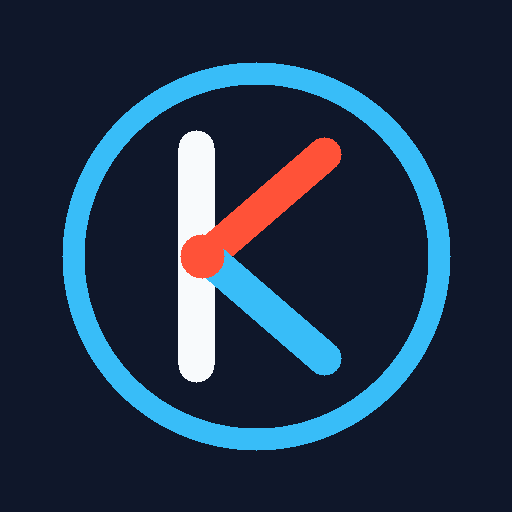

<h1 align="center">
   krig
</h1>

<p align="center">
  <a href="LICENSE"></a>
  = 20" />
  
</p>

<p align="center">
  English | <a href="README.ko.md">한국어</a>
</p>

<p align="center">
  <strong>One command (`/krig`). Twelve lazy-loaded engineering playbooks. Zero-dependency verification levers.</strong>
</p>

`krig` (`Krill` + `Rig`) is a single-entrypoint, auto-routing engineering workflow plugin and skill for **Claude Code**, **Codex CLI**, and **Antigravity (`agy`)**. Instead of cluttering your slash menu with a dozen separate commands or bloating always-on context with heavy coding rubrics, `/krig` classifies your request deterministically via [route.mjs](skills/krig/scripts/route.mjs) and loads only the exact playbook and zero-dependency Node.js CLI levers needed for the task.

## Install

Requires Node.js 20 or later (zero npm runtime dependencies).

### Claude Code (`claude`)

Inside an interactive Claude Code session:

```text
/plugin install krig --marketplace craftowen/krig
```

Or from your terminal:

```bash
claude plugin marketplace add craftowen/krig
claude plugin install krig@krig
```

### Codex CLI (`codex`)

```bash
codex plugin marketplace add craftowen/krig
codex plugin add krig@krig
```

### Antigravity CLI (`agy`)

```bash
agy plugin install https://github.com/craftowen/krig
```

### Symlink Install Across All Three CLIs (Single Checkout)

If you want one local checkout wired directly into `~/.claude/skills/krig`, `~/.codex/skills/krig`, `~/.agents/skills/krig`, and `~/.gemini/antigravity-cli/skills/krig` simultaneously:

```bash
git clone https://github.com/craftowen/krig.git
cd krig
./scripts/install.sh
./scripts/install.sh --check
```

## Usage

Invoke `/krig` in Claude Code and Antigravity (`/krig:krig` when plugin-namespaced), or `$krig` / `/krig` in Codex CLI:

```text
/krig Scope out a new webhook settlement pipeline, trim speculative requirements, and split into vertical slices
/krig Analyze the blast radius of changing parseCliFlags and prove what could break
/krig Design the payment adapter boundary and module interface
/krig Model-check the delivery checkpoint retry state machine for deadlocks and duplicate-send invariants
/krig Implement PROJ-120 end-to-end and verify
/krig Reproduce and fix the intermittent timeout bug via binary search instrumentation
/krig Audit this repo for over-engineering bloat and rot-risk shortcut debt
/krig Pick up where the last session left off and finish the implementation
/krig Run pre-ship readiness check and prepare a 1-minute PR briefing
/krig Run a blinded A/B evaluation comparing with-krig vs no-skill on held-out assertions
/krig Encode the root cause from this session into a structural gate so it never recurs
```

Force a specific route with the `route:<name>` prefix (for example `/krig route:recon ...`, `/krig route:model ...`, `/krig route:slim ...`, `/krig route:ship ...`, `/krig route:eval ...`, or `/krig route:full ...`).

## Auto-Routing Architecture (12 Playbooks)

The entry router ([SKILL.md](skills/krig/SKILL.md) + [route.mjs](skills/krig/scripts/route.mjs)) maps each prompt onto a DAG of twelve playbooks and separates human-in-the-loop scope alignment (`hitl` gear) from autonomous execution (`afk` gear):

| Route | Gear | Playbook | Follow-on Chain | Bundled CLI Lever |
|---|---|---|---|---|
| `align` | `hitl` | [align.md](skills/krig/playbooks/align.md) | none | [ledger.mjs](skills/krig/scripts/ledger.mjs) (requirement deletion ledger + <10% add-back warning) |
| `recon` | `afk` | [recon.md](skills/krig/playbooks/recon.md) | none | [recon.mjs](skills/krig/scripts/recon.mjs) (`how`, `why`, `blast` lexical symbol/caller/boundary/pickaxe analyzer) |
| `design` | `afk` | [design.md](skills/krig/playbooks/design.md) | `verify` | [deepening.md](skills/krig/references/deepening.md) (deep modules, 2-adapter seam, 4-tier dependency model) |
| `model` | `afk` | [model.md](skills/krig/playbooks/model.md) | `verify` | [statecheck.mjs](skills/krig/scripts/statecheck.mjs) (bounded BFS explicit-state model checker + shortest counterexample + Mermaid) |
| `drive` | `afk` | [drive.md](skills/krig/playbooks/drive.md) | `demock`, `verify` | [decision-log.mjs](skills/krig/scripts/decision-log.mjs) (`feature`, `bugfix`, `hillclimb` TSV audit trail) |
| `demock` | `afk` | [demock.md](skills/krig/playbooks/demock.md) | `verify` | [scan.mjs](skills/krig/scripts/scan.mjs) (lexical production scanner for mocks, swallowed errors, permissive guards) |
| `verify` | `afk` | [verify.md](skills/krig/playbooks/verify.md) | none | [standards-baseline.md](skills/krig/references/standards-baseline.md), [leakage-8.md](skills/krig/references/leakage-8.md), [ship-check.mjs](skills/krig/scripts/ship-check.mjs) (dual-axis review + `patch-id` stamp) |
| `slim` | `afk` | [slim.md](skills/krig/playbooks/slim.md) | none | [slim.mjs](skills/krig/scripts/slim.mjs) (unused deps, pass-through barrels, orphan modules, `rotRisk` debt ledger) |
| `resume` | `afk` | [resume.md](skills/krig/playbooks/resume.md) | none | [checkpoint.mjs](skills/krig/scripts/checkpoint.mjs) (`.krig/handoff.json` checkpointing + commit/patch drift detection) |
| `ship` | `afk` | [ship.md](skills/krig/playbooks/ship.md) | none | [ship-check.mjs](skills/krig/scripts/ship-check.mjs) (rebase-safe `git patch-id` freshness, hazard scan, 40-line PR briefing gate) |
| `eval` | `afk` | [eval.md](skills/krig/playbooks/eval.md) | none | [ab-eval.mjs](skills/krig/scripts/ab-eval.mjs) (blinding leak checker + held-out A/B oracle comparator) |
| `backprop` | `afk` | [backprop.md](skills/krig/playbooks/backprop.md) | none | [unwrap.mjs](skills/krig/scripts/unwrap.mjs) (5-tier enforcement pyramid + lossless `v0` markdown reflow) |

See [GLOSSARY.md](GLOSSARY.md) for canonical domain terms and [CONTRIBUTING.md](docs/CONTRIBUTING.md) for static gate and authoring rules.

## Blinded Quantitative A/B Benchmark (`no-skill` vs `with-krig`)

Measured on the 6-task, 60-assertion held-out suite in [benchmarks/README.md](benchmarks/README.md) with identical models, initial git commits, and physically isolated oracle code (`0` infrastructure errors across all 24 sessions):

| Model | `no-skill` Pass Rate | `with-krig` Pass Rate | Pass Rate Lift | Defect Escapes (`no-skill` vs `with-krig`) | Paired Task Outcomes (`with-krig`) |
|---|---|---|---|---|---|
| `claude-sonnet-5-5` (`6` tasks, `60` assertions) | `95.0%` (`57/60`) | **`100.0%` (`60/60`)** | **`+5.0%p`** | `2` vs **`0` (`-100%`)** | `2` wins, `4` ties, `0` losses (`-4.5%` prod LOC) |
| `claude-haiku-5-5` (`6` tasks, `60` assertions) | `93.3%` (`56/60`) | **`96.7%` (`58/60`)** | **`+3.4%p`** | `2` vs **`1` (`-50%`)** | `1` win, `4` ties, `1` loss |
| **Combined (`12` paired runs, `120` assertions)** | `94.2%` (`113/120`) | **`98.3%` (`118/120`)** | **`+4.1%p`** | `4` vs **`1` (`-75%`)** | **`3` wins, `8` ties, `1` loss** |

## Development & Verification

```bash
npm run check
npm test
```

## License

[MIT](LICENSE)
